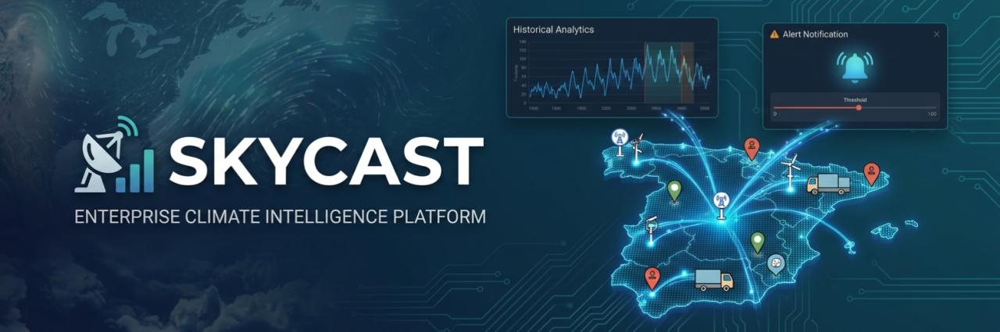
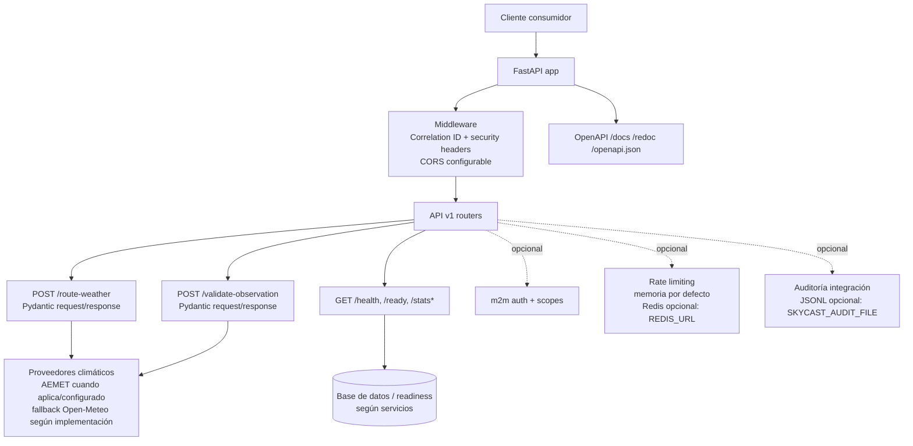
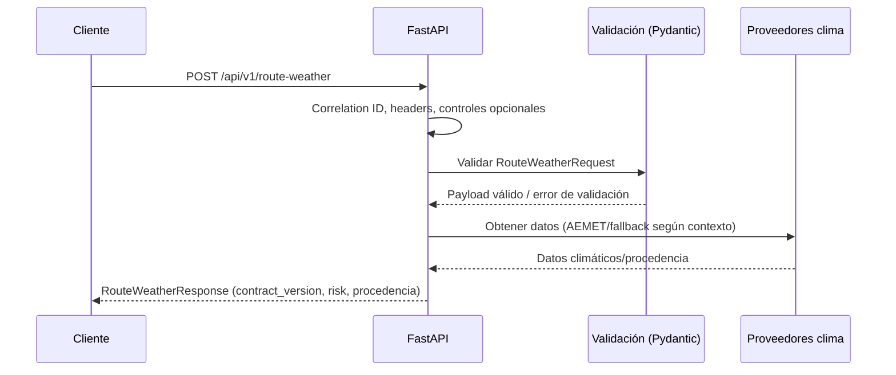

# SkyCast

**Climate Intelligence & Integration API**

Servicios FastAPI para integración climática por contratos (ruta y validación de observaciones), con controles operativos configurables y documentación OpenAPI.

<p>
  
  
  
  
  
  <a href="https://github.com/juandelaf1/SkyCast/actions/workflows/ci.yml"></a>
</p>

<p>
  
</p>

> **Estado:** este README refleja comportamiento **verificado en el código** del repositorio (`portfolio-analisis`). Algunas capacidades son opcionales o dependen de configuración/proveedores externos. El [case study del portfolio](https://juandelaf1.github.io/projects/sky-cast) puede describir una versión anterior.

---

## Overview

| Aspecto | Detalle (verificado / según configuración) |
|---|---|
| **Propósito** | Exponer contratos climáticos para integración (p. ej., logística) y validación de observaciones, con operación observable. |
| **Consumidores típicos** | Servicios cliente que integran datos climáticos por API (contratos HTTP JSON). |
| **Capacidades principales** | `POST /api/v1/route-weather`, `POST /api/v1/validate-observation`, health/readiness; OpenAPI en `/openapi.json`, `/docs`, `/redoc`. |
| **Operación** | m2m opcional por scopes, rate limiting (memoria por defecto; Redis opcional), auditoría, `X-Correlation-Id`, CORS configurable, cabeceras de seguridad, HSTS opcional. |
| **Limitaciones relevantes** | Procesamiento periódico/ETL según configuración (no streaming garantizado); dependencia de proveedores/configuración; rate limit in-memory no distribuido sin Redis operativo. |

## Architecture

Diagrama de alto nivel basado en componentes presentes en el código (`FastAPI`, routers v1, validación Pydantic, middleware, controles opcionales). Los elementos marcados como *(opcional)* dependen de configuración.



<sub>*`/health/stats` requiere autenticación según la implementación.</sub>

## Data flow (ejemplo: route-weather)



## API reference

| Method | Endpoint | Purpose | Notes |
|---|---|---|---|
| `POST` | `/api/v1/route-weather` | Clima por waypoints/ruta | Contrato `skycast-route-weather/0.1`; riesgo/penalización y procedencia en respuesta |
| `POST` | `/api/v1/validate-observation` | Validar observación reportada | Contrato `skycast-validate-observation/0.1`; validación cruzada (estimación, no medición directa) |
| `GET` | `/api/v1/health` | Estado, versión, métricas/capacidades | Respuesta incluye información operativa declarada |
| `GET` | `/api/v1/health/ready` | Readiness (conectividad DB) | Comprobación de disponibilidad |
| `GET` | `/api/v1/health/stats` | Estadísticas operativas | Requiere autenticación según implementación |
| `GET` | `/openapi.json`, `/docs`, `/redoc` | Documentación OpenAPI | Snapshot en repo: `docs/openapi.json` |

> Verifica rutas/métodos/esquemas contra `/openapi.json` o `/docs` en el entorno objetivo.

## API examples

### `POST /api/v1/route-weather`

**Request** (campos verificados en `RouteWeatherRequest`):

```json
{
  "origen_lat": 40.4168,
  "origen_lon": -3.7038,
  "destino_lat": 41.3874,
  "destino_lon": 2.1686,
  "num_samples": 5
}
```

**Response (estructura verificada):** `RouteWeatherResponse` incluye `contract_version`, `waypoints[]` (clima/alerta/fuente/procedencia por punto), `hazard_level`, `duration_penalty_pct`, `co2_penalty_pct`, `summary`, `fuente`, `procedencia`. Los valores dependen de fuentes/disponibilidad.

```bash
curl -sS -X POST "http://127.0.0.1:8000/api/v1/route-weather" \
  -H "Content-Type: application/json" \
  -d '{"origen_lat":40.4168,"origen_lon":-3.7038,"destino_lat":41.3874,"destino_lon":2.1686,"num_samples":5}'
```

### `POST /api/v1/validate-observation`

**Request** (campos verificados en `ObservationReport`): `lat`, `lon`, `reporte` obligatorios; `temperatura_c`, `timestamp`, `fuente_reporte` opcionales.

```json
{
  "lat": 40.4168,
  "lon": -3.7038,
  "reporte": "helada intensa en la calzada",
  "temperatura_c": -2.0,
  "fuente_reporte": "transportista"
}
```

**Response (estructura verificada):** `ValidationResponse` incluye `contract_version` (`skycast-validate-observation/0.1`), `valido`, `confianza` (0–100), `estaciones_cercanas[]`, `nota`, `procedencia`.

```bash
curl -sS -X POST "http://127.0.0.1:8000/api/v1/validate-observation" \
  -H "Content-Type: application/json" \
  -d '{"lat":40.4168,"lon":-3.7038,"reporte":"helada intensa en la calzada","temperatura_c":-2.0}'
```

### Health checks

```bash
curl -sS "http://127.0.0.1:8000/api/v1/health"
curl -sS "http://127.0.0.1:8000/api/v1/health/ready"
```

**Errores relevantes (según configuración):** validación 422 (Pydantic), 401/403 cuando m2m está activo/configurado y faltan credenciales o scope, 429/rate limit según backend/límites, 500 gestionado por handler global.

## Security & operations

| Área | Comportamiento verificado |
|---|---|
| **m2m (opcional)** | Scopes por contrato (`weather:route`, `weather:validate`); cabeceras `X-API-Key` o `Authorization: Bearer ...` cuando aplica; activación estricta con `SKYCAST_M2M_REQUIRED`. |
| **Rate limiting** | Memoria por defecto; **Redis opcional** con `REDIS_URL` (backend distribuido cuando está disponible). Límite configurable (p. ej. `SKYCAST_M2M_RATE_LIMIT`, por defecto `120/minute` en contratos). |
| **Auditoría** | Eventos de integración (`contract_version`, `outcome`, `correlation_id`, `caller` según estado); JSONL opcional `SKYCAST_AUDIT_FILE`. No loguear secretos/PII. |
| **Trazabilidad** | `X-Correlation-Id` propagado/generado (también acepta `X-Request-Id`). |
| **CORS / headers** | `SKYCAST_CORS_ORIGINS` (por defecto `*`); `X-Content-Type-Options`, `X-Frame-Options`, `Referrer-Policy`; HSTS solo si `SKYCAST_HSTS=true`. |

<details>
<summary><strong>Variables de entorno (configuración, verificar valores por defecto en código/.env)</strong></summary>

| Variable | Purpose | Required |
|---|---|---|
| `SKYCAST_CORS_ORIGINS` | Orígenes CORS permitidos (coma-separados) | Configurable |
| `SKYCAST_M2M_REQUIRED` | Exigir autenticación m2m | Optional |
| `SKYCAST_M2M_KEYS` | Credenciales m2m `caller:secret:scope1\|scope2` (`;` separados) | Optional |
| `SKYCAST_M2M_API_KEY` / `SKYCAST_M2M_SCOPES` / `SKYCAST_M2M_CALLER` | Configuración m2m alternativa | Optional |
| `SKYCAST_M2M_RATE_LIMIT` | Límite de tasa (p. ej. `120/minute`) | Optional |
| `REDIS_URL` | Backend Redis para rate limiting distribuido | Optional |
| `SKYCAST_AUDIT_FILE` | Ruta JSONL para auditoría | Optional |
| `SKYCAST_HSTS` | Habilitar HSTS (`true`) | Optional |
| `AEMET_API_KEY` | Credencial proveedor AEMET (cuando aplica) | Según integración |

**Secret management:** no commitear credenciales; usar variables de entorno o un secret manager. No incluir claves reales en ejemplos.

</details>

## Installation & quick start

**Prerequisites:** Python (CI usa 3.13), pip; Docker opcional. Dependencias externas (p. ej. AEMET) requieren credenciales/configuración según el caso.

```bash
# 1) Clone
git clone https://github.com/juandelaf1/SkyCast.git
cd SkyCast

# 2) Virtual environment
python -m venv .venv
# Windows (PowerShell): .\.venv\Scripts\Activate.ps1
# Windows (cmd): .venv\Scripts\activate
# Linux/macOS: source .venv/bin/activate

# 3) Install
pip install -r requirements.txt

# 4) Configure environment
# Existe `.env.example` en el repositorio (verificado): úsalo como base.
# cp .env.example .env   (ajusta valores; no commitear secretos)

# 5) Run
uvicorn app.main:app --reload

# 6) Docs
# http://127.0.0.1:8000/docs
# http://127.0.0.1:8000/openapi.json
```

Plantilla de despliegue: `docker-compose.prod.yml`. Revisar `DECISION_LOG.md` y documentación operativa del repositorio.

## Limitations

- **No streaming garantizado:** monitorización/procesamiento periódico o ETL según configuración.
- **Dependencias externas:** disponibilidad/calidad sujetas a proveedores (AEMET/Open-Meteo, etc.) y credenciales (`AEMET_API_KEY` cuando aplica).
- **Rate limiting:** en memoria no es distribuido sin `REDIS_URL` y backend Redis operativo.
- **Auditoría/secretos avanzados:** rotación, centralización y gestión dependen de la infraestructura.
- **Material histórico:** el portfolio/case study puede diferir del estado actual; contrastar con `/docs`, `docs/openapi.json`, tests y workflows.

## Documentation & references

- OpenAPI (runtime): `/openapi.json` · Swagger: `/docs` · ReDoc: `/redoc`
- OpenAPI (repo): [`docs/openapi.json`](docs/openapi.json)
- Case study (puede describir versión anterior): [juandelaf1.github.io/projects/sky-cast](https://juandelaf1.github.io/projects/sky-cast)
- Decisiones: `DECISION_LOG.md` (incluir/enlazar solo si existe en la rama objetivo)
- CI: [`.github/workflows/ci.yml`](.github/workflows/ci.yml)

## Authorship

**Juan de la Fuente** — [@juandelaf1](https://github.com/juandelaf1)
